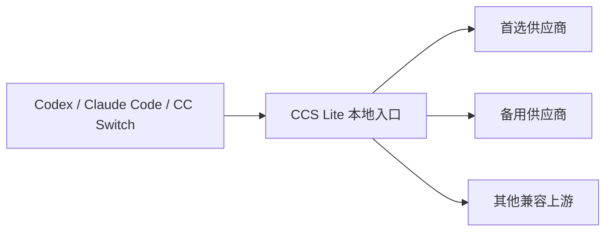
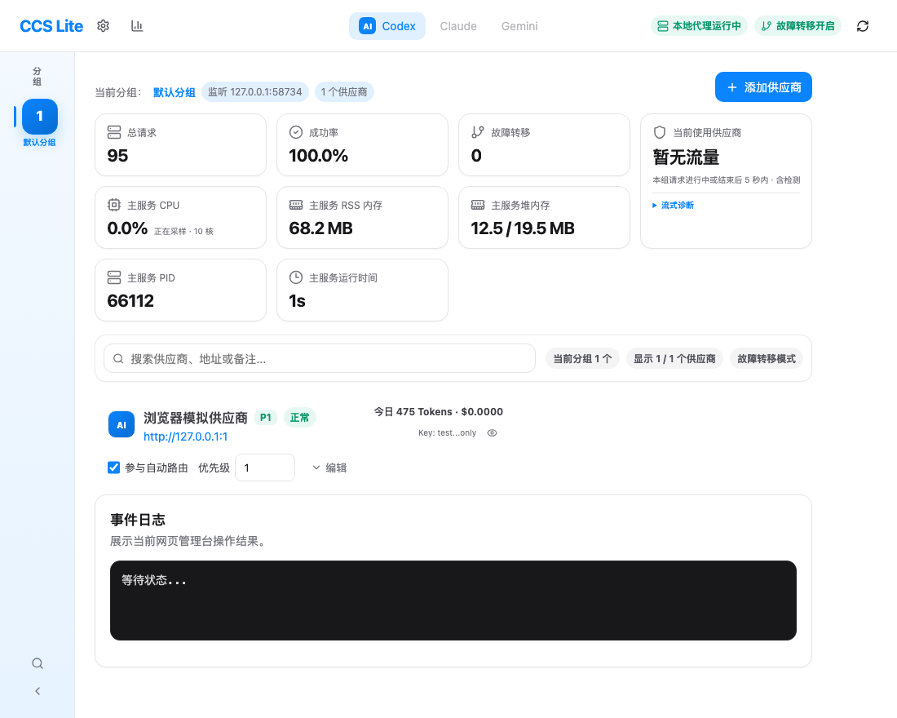

# CCS Lite（Lite CC Switch）

[](https://github.com/Red-noblue/ccslite/actions/workflows/ci.yml)
[](LICENSE)
[](#环境要求)

**面向 Codex 与 Claude Code 的本地 AI API 网关：SSE 输出前故障转移、用量统计与会话级在线升级。**

Local AI API gateway for Codex and Claude Code: multi-provider routing, pre-output SSE failover, usage analytics, and session-aware upgrades.

将多个兼容上游收敛为一个本地入口，为 Codex、Claude Code、CC Switch 等客户端统一管理供应商优先级、故障回退和业务用量。支持代理 OpenAI Responses、Chat Completions 和 Anthropic Messages 入口；具体协议和模型能力由上游提供。

CCS Lite 是可独立运行的本地 API 网关，也可以与 CC Switch 配合：继续用 CC Switch 管理客户端配置，让请求经过 CCS Lite，再由它按运行状态选择上游供应商。

[快速开始](#快速开始) · [界面预览](#界面预览) · [在线升级与回退](#固定监听前置器) · [English overview](#english-overview) · [问题反馈](https://github.com/Red-noblue/ccslite/issues)

## 适合哪些场景

| 你的需求 | CCS Lite 的处理方式 |
| --- | --- |
| 多个供应商之间需要自动切换 | 按优先级选择上游，失败时重试或回退，确认恢复后再迁回 |
| 想知道今天用了多少 token | 供应商卡片展示今日业务用量，统计页查看历史、探测用量和费用估算 |
| 多个对话进行中仍要更新服务 | 固定监听前置器保持入口，各会话在当前请求及检查点完成后逐步交接 |
| 不同客户端需要不同供应商组合 | 分组管理供应商引用、路由开关和独立端口 |



这是独立仓库，所有命令均在仓库根目录执行，不需要外层工具包或便携式 CLI。服务和配置保存在本机，供应商 API 请求通过用户配置的上游处理。

## 功能

- 管理多个供应商的上游地址、认证、模型兼容性和自动路由开关。
- 按数字优先级、同优先级的名称顺序选择供应商，支持重试、故障转移、粘滞会话和恢复后回迁。
- 按分组管理供应商引用和独立监听端口，同一供应商的后台恢复探测按进程共享。
- 代理 `/v1/responses`、`/v1/chat/completions` 和 `/v1/messages` 等入口；实际可用能力取决于上游。
- 记录业务与 CCOK 探测用量，供应商卡片显示客户端时区下的今日业务用量，统计页保留完整历史汇总。
- 提供价格实验、人民币与美元计价以及汇率系数缓存。
- 固定监听前置器支持逐会话交接、整体交接和固定版本回退；配置、用量、诊断经前置器协调写入。

## 与相近项目的定位

这些项目解决的问题有交集，但目标场景不同。以下对比依据各项目公开的 README，不代表完整功能逐项审计，也不表示其他项目缺少其文档未说明的能力。

- [CC Switch](https://github.com/farion1231/cc-switch)：桌面端管理多种 AI 编程工具的供应商配置，并提供本地路由和故障转移。适合集中管理客户端配置、MCP、Skills 和提示词。CCS Lite 可以放在 CC Switch 后方作为独立 API 网关；两者在供应商路由上有交集，所以“自动切换”本身不是 CCS Lite 的独有卖点。
- [LiteLLM](https://github.com/BerriAI/litellm)：面向多种模型和团队网关场景，公开功能包括多 provider 统一接口、虚拟密钥、成本跟踪、guardrails、负载均衡和管理界面。它更适合需要广泛模型接入和团队治理的部署。
- [New API](https://github.com/QuantumNous/new-api)：自托管的多用户 AI 网关，公开功能包括渠道与模型管理、访问控制、用户额度、用量和成本统计，面向应用、代理和团队共享 API。
- **CCS Lite**：聚焦本机 Codex、Claude Code 等客户端后方的轻量运行时网关。重点是按请求查看供应商尝试和 SSE 故障阶段、按会话保持路由上下文，以及用固定监听前置器逐步交接工作进程并回退到指定版本；不以多租户、用户配额或百家模型接入为目标。

选择方式很直接：管理多种客户端配置可选 CC Switch；需要团队级多 provider 网关和权限/额度治理可评估 LiteLLM 或 New API；希望在自己的工作站运行一个可观测、可按会话更新的 API 网关，可评估 CCS Lite。它们可以组合使用，不必视为互斥替代品。

## SSE 与升级的可靠性边界

CCS Lite 会在开始向客户端提交响应前检查 SSE 首包和事件前导。若上游在这个安全窗口内断连、超时或返回可重试错误，且下一家供应商可用，请求可以转到下一家；例如集成测试覆盖了首家已发送 `response.created`、`response.in_progress` 后断流，备用供应商成功返回完整 `response.completed` 的情况。切换成功时，客户端收到备用供应商的完整响应，不会收到首家尚未提交的失败；如果没有可用候选，仍可能返回 502/503。相关测试见 [SSE 输出前故障转移](tests/integration/test-stream-failover-before-output.mjs)。

如果有效输出已经开始发送，代理不会把第二家供应商的响应拼接到这条 SSE 中；当前请求仍可能断流，是否自动重试取决于客户端。这样可以避免把两个供应商的事件、响应 ID 或工具调用混成同一个结果。一次输出前重试也可能已被首家上游计费。

版本更新时，固定端口前置器让正在传输的 SSE 留在原工作进程完成，再按请求和会话检查点逐步交接。它不会把已经开始的 SSE 中途搬到新进程。供应商全部不可用、错误不可重试、交接队列达到边界或进程发生无法恢复的故障时，仍可能返回错误；项目不承诺所有故障下对话都不中断。交接演练见 [会话逐步交接测试](tests/integration/test-handoff-session.mjs)。

## 界面预览



截图来自隔离演示实例，供应商、密钥和用量均为虚构数据。页面包含供应商优先级、自动路由状态、今日用量和进程资源信息。

## 环境要求

- 最低 Node.js 18.17；推荐 Node.js 22 或 24，以及配套的 npm。
- macOS 或 Linux；Windows 建议使用 WSL2。前置器本机控制依赖 Unix 套接字，`restart.sh` 还需要 Bash、curl、lsof 和 ps。
- 使用浏览器访问管理台；供应商地址和认证由用户自行添加，仓库不附带账号或密钥。

## 快速开始

```bash
git clone https://github.com/Red-noblue/ccslite.git
cd ccslite
npm ci
npm start
```

打开 <http://127.0.0.1:15720>，添加自己的供应商并配置“参与自动路由”和优先级。首次启动会在本仓库的 `data/` 中建立空配置；无需从其他项目复制运行数据。未添加供应商时，管理台可以打开，业务代理尚无可用上游。

仓库包含可直接使用的 `public/` 页面。修改前端后运行 `npm run web:build`；仅安装并启动现有页面时不必重新构建。

`npm start` 是直接启动方式，便于首次配置和开发。长期运行及在线交接建议完成下面的前置器准备后使用 `npm run start:handoff`。同一端口只使用一种启动方式。

### 客户端连接

将兼容客户端的上游地址设置为 `http://127.0.0.1:15720/v1`。客户端若自行拼接 `/v1`，应按其配置规则填写根地址，避免重复路径。新增分组使用该分组配置的端口。

配置本地代理令牌后，代理请求通过 `x-lite-ccswitch-token` 请求头携带令牌。上游供应商认证单独保存在供应商配置中；它与本地管理和代理访问令牌是不同用途。

### 更换端口

直接启动时可用环境变量选择端口：

```bash
LITE_CCSWITCH_PORT=15725 npm start
```

前置器使用显式参数，例如 `npm run start:handoff -- --port 15725`。配置中默认分组的端口必须与前置器公开端口一致，其他分组端口也必须空闲；复制现有配置后应先检查这些端口。

## 固定监听前置器

前置器持有公开端口，工作进程使用内部端口。工作进程升级时可以保持前置器运行。首次使用需要已有的第 2 版配置和一个经过校验的独立回退包。

### 首次准备

先按快速开始运行一次 `npm start`，完成本机配置。然后按一次 `Ctrl+C`，等进程排空退出，再执行：

```bash
node release.mjs snapshot . ../ccslite-baseline-0.2.19 baseline-0.2.19
node release.mjs verify ../ccslite-baseline-0.2.19
mkdir -p fallback-releases
mv ../ccslite-baseline-0.2.19 fallback-releases/
npm run start:handoff
```

快照工具要求输出位于源码目录之外，因此先生成到相邻目录，再移动到 `fallback-releases/`。目标目录不能已经存在；重复执行前应先检查已有备份，不能覆盖正在使用的回退包。快照包括代码、页面和已安装依赖，不包括 `data/`、认证、Git 元数据或其他版本包。

`--workspace` 默认从本仓库启动工作进程，使用本仓库的 `data/`、15720 端口和 `fallback-releases/` 中唯一的非隐藏回退目录。回退目录中只放一个版本，也可以使用 `--fallback /绝对路径/备份` 显式指定。

出现 `"event":"ready"` 后，在另一个终端检查：

```bash
node handoff-runner.mjs status --data-dir data
```

确认 `phase` 为 `active`、`rollbackRoot` 指向预期备份，并从 `/api/status` 的 `build.version`、`build.releaseId` 和 `build.codeHash` 核对实际运行版本。

### 在线升级和回退

先在另一个源码目录准备并测试新版本、安装依赖及构建前端，再生成版本包。以下命令中的路径需要替换为实际位置，版本目录必须长期保留：

```bash
node release.mjs snapshot /绝对路径/新源码 ../ccslite-next next-release
node release.mjs verify ../ccslite-next
mkdir -p releases
mv ../ccslite-next releases/next-release
node handoff-runner.mjs upgrade-session --data-dir data --candidate releases/next-release
node handoff-runner.mjs status --data-dir data
```

`upgrade-session` 让新会话进入新版本；旧会话在当前所有并发请求及完成检查点结束后逐步迁移，持续输出中的 SSE 留在旧进程完成。`active_parallel` 表示新旧版本短暂并行，`session.legacySessionCount` 和 `session.pendingCheckpoints` 可用于观察进度。没有可靠会话标识的客户端宜使用整体 `upgrade`，默认等待排空最多 300 秒；超时取消本次升级并恢复原服务，不强杀旧流。

```bash
node handoff-runner.mjs upgrade --data-dir data --candidate releases/next-release
node handoff-runner.mjs rollback --data-dir data
```

`rollback` 始终使用启动时指定的固定回退包。配置和新增用量继续沿用同一数据目录，不恢复旧账本；升级不会自动更换固定备份。候选启动失败、接管后崩溃和连续恢复失败的处理不同，应检查状态及事件。健康检查异常只告警，不凭健康超时强行断开活动请求。

已崩溃进程上的网络连接无法凭空恢复，系统不会重放已经完成的业务请求。队列容量有限，上游兼容性、客户端超时、进程崩溃或资源耗尽仍可能导致请求失败；在线交接不代表所有故障下都保证不断流。

### 停止与维护

前置器在原终端按一次 `Ctrl+C`，会等待活动请求和收尾任务完成，看到 `"event":"stopped"` 后再重新启动。第二次停止信号会强制断开连接。

只有前置器本身的代码或协议变化时，才需要维护窗口重启前置器；单独升级工作进程不会加载新的前置器代码。涉及配置格式变化的版本也必须先检查兼容性。不要直接结束它管理的工作子进程。

`restart.sh <端口>` 只用于直接启动的开发实例，不适用于前置器。它拒绝处理前置器和其他项目占用的端口；直启滚动重启存在重新监听的间隙，持续服务优先使用前置器。

## 数据、认证和日志

默认数据目录是本仓库的 `data/`。供应商密钥以本机配置文件保存，依靠文件权限和本机访问控制保护，不是加密保险库。

| 内容 | 位置和用途 |
| --- | --- |
| 供应商及分组配置 | `data/config.json`，包括上游地址和认证 |
| 完整用量记录 | `data/usage.jsonl`，追加写入；累计统计读取全部历史 |
| 价格实验 | `data/price-lab.json` 及分组实验文件 |
| 诊断与交接事件 | `data/413-diagnostics.jsonl`、`data/handoff-events*.jsonl` |
| 暂存、锁和交接状态 | `data/` 下的内部文件，不应手动覆盖正在使用的文件 |

事件日志按大小轮换并保留归档，默认不自动删除历史。用量记录不是可从配置重建的数据，请单独备份。复制运行数据到其他机器前先完整停止服务；不要把两台服务指向同一份数据。

启动终端过滤高频交接明细，排查时使用本机 CLI：

```bash
node handoff-runner.mjs events --data-dir data --tail 50
node handoff-runner.mjs events --data-dir data --event handoff_usage_committed --tail 20
```

需要设置访问令牌时，可复制无密钥的示例，然后编辑本机文件：

```bash
mkdir -p data
cp examples/runtime.env.example data/runtime.env
chmod 600 data/runtime.env
```

程序自动读取 `data/runtime.env`，显式环境变量优先；文件只解析 `LITE_CCSWITCH_` 赋值，不执行 shell 命令。示例中的令牌必须替换后再启用。

默认只监听 `127.0.0.1`。需要非本机访问时，必须同时配置代理令牌和管理令牌，使用 HTTPS 反向代理；前置器的监听地址使用 `--host` 指定。没有独立管理令牌时会复用代理令牌。通过反向代理开放本机监听端口时也应启用令牌。

## 路由和恢复规则

每个分组的 `providerRefs` 决定该分组的成员、参与自动路由开关和排序。供应商认证和地址是共享配置；某供应商只要被任一分组用于自动路由，就可能保留一条共享后台恢复探测队列。业务请求及 CCOK 都可能产生供应商费用。

后台恢复确认按同一供应商、同一模型累计两次连续完整成功；业务请求成功和 CCOK 可以共同提供证据。确认后，符合条件的低优先级粘滞会话可以回迁。`successStreak=0` 也可能表示已完成确认，应同时查看 `recoveryConfirmed` 等状态。手动测试沿用独立的人工确认路径。

优先级恢复和版本交接都不会在已经输出的 SSE 中途切换。下一版本接收响应 ID 对应的供应商和有序回退链，不迁移完整断路器、恢复健康或全部粘滞状态。上游不识别其他供应商生成的 `previous_response_id` 时，仍可能沿回退链使用原供应商。

## 开发与验收

```bash
npm ci
npm run check:public
npm run check
npm test
npm run test:workspace
```

`check` 检查服务入口语法并构建前端；`test` 运行单元和集成测试。集成测试和源码交接演练使用独立数据、随机本机端口和模拟上游，不需要真实密钥。源码交接演练自动创建代码与固定回退副本，不读写或清理仓库自己的 `data/`。

前端热更新在另一个终端运行 `npm run web:dev`，默认监听 15723，将 `/api` 和 `/v1` 转发到 127.0.0.1:15720。测试前确保这些端口属于自己的开发实例。浏览器手工验收脚本需要 Chrome，可通过 `LITE_TEST_CHROME` 指定路径；设置 `LITE_TEST_SCREENSHOT=docs/images/dashboard.png` 可重新生成模拟数据截图。性能对比脚本需要显式提供 `LITE_CCSWITCH_TEST_BASELINE`。实际 Codex CLI 手工演练还需要另外提供 CLI 和便携工具，不属于普通安装或 CI 的必要依赖。

GitHub Actions 配置覆盖 Linux/Node.js 22 和 macOS/Node.js 24 的安装、构建、测试及源码交接演练。首次公开前应以实际 CI 结果为准，本机检查不能代替远程平台验证。

## 发布目录与许可证

仓库只包含代码、测试、现有辅助文档和当前构建页面。`data/`、认证目录、`node_modules/`、`releases/`、`fallback-releases/` 和历史备份被 `.gitignore` 排除。`check:public` 另外检查待发布文件中的禁止路径、私钥和常见令牌格式；自动扫描不能代替人工检查提交差异。

`docs/` 中的日记和验收记录是历史资料，其中的目录、端口和版本号只反映当时环境；当前操作以本 README 为准。用于长期运行或回退的版本目录必须放在稳定位置，不能放在随时可能清理的临时目录中。

界面和部分供应商管理交互沿用 [CC Switch](https://github.com/farion1231/cc-switch) 的设计，感谢原项目及其贡献者。项目使用 [MIT License](LICENSE)，保留原许可证中的版权声明。问题反馈见 [GitHub Issues](https://github.com/Red-noblue/ccslite/issues)。提交问题时请移除真实密钥、供应商认证和个人请求内容。

## English overview

CCS Lite is a self-hosted local AI API gateway and provider manager for Codex, Claude Code, CC Switch, and compatible clients. It can run on its own or behind CC Switch, which also provides local routing and automatic failover. CCS Lite focuses on the runtime gateway, request-level diagnostics, pre-output SSE failover, usage tracking, and session-aware worker upgrades.

Features include priority-based routing, automatic failover, sticky sessions with recovery migration, per-group endpoints, daily token usage, historical billing estimates, and SSE streaming. A fixed-port supervisor supports gradual worker upgrades at request boundaries and a designated fallback release. Retryable SSE failures can switch providers before response output begins. Once output has been sent, the stream cannot be safely continued with another provider, and the client may need to retry. The project does not promise uninterrupted service through every failure.

Use Node.js 22 or 24 on macOS or Linux; WSL2 is recommended on Windows. Start with the four commands in [Quick start](#快速开始). No outer toolkit or portable CLI is required. Provider credentials and runtime data stay outside Git. See the [MIT license](LICENSE) and [issue tracker](https://github.com/Red-noblue/ccslite/issues).

如果它帮助你减少了供应商切换和服务维护的麻烦，欢迎 Star 或提交使用反馈。报告问题时，请附上版本、脱敏后的复现步骤和相关错误；也欢迎改进文档或提交修复。
